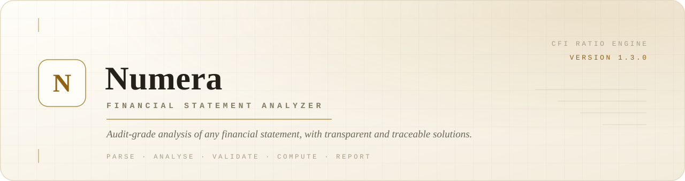
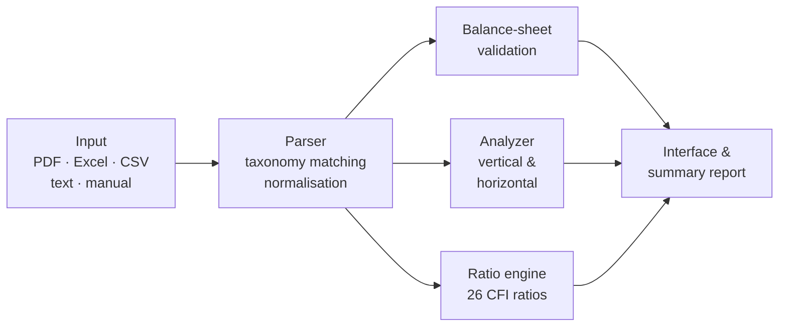

<div align="center">
  
</div>

<div align="center">

[](https://github.com/jacobconradquendangan-portfolio/Numera/actions/workflows/ci.yml)
[](LICENSE)


**Audit-grade analysis of any financial statement — every figure traceable to its formula and source line item.**

</div>

---

## Overview

Numera ingests corporate financial statements, normalises the line items, verifies the accounting
identity `Assets = Liabilities + Equity`, runs vertical and horizontal analysis, and computes the
full Corporate Finance Institute (CFI) financial-ratio suite — with a transparent, step-by-step
solution behind every number.

It is a self-contained Next.js application built on a bespoke, dependency-light financial engine
(`parser → analyzer → ratios`) and presented through a warm, ledger-inspired interface. No data
leaves your device.

### Table of contents

- [Features](#features)
- [Ratio coverage](#ratio-coverage)
- [Architecture](#architecture)
- [Tech stack](#tech-stack)
- [Getting started](#getting-started)
- [Usage](#usage)
- [Project structure](#project-structure)
- [Testing](#testing)
- [Contributing](#contributing)
- [License](#license)

---

## Features

| Capability | Description |
| --- | --- |
| **Multiple input paths** | Manual entry with an editable period grid and a searchable line-item combobox; paste statement text; or upload PDF, Excel (`.xlsx` / `.xls`) or CSV. |
| **Automatic line-item mapping** | A 44-category taxonomy matched by exact, substring and fuzzy (Jaccard ≥ 0.6) rules, with unit scaling auto-detected from `(in thousands/millions)` notes. |
| **Balance-sheet validation** | Proves `Assets = Liabilities + Equity` within a configurable tolerance and surfaces clear, actionable warnings. |
| **Vertical & horizontal analysis** | Every line item as a share of revenue / total assets, plus period-over-period variance (Δ and %) in sortable tables. |
| **CFI ratio engine** | 26 ratios across liquidity, profitability, leverage, efficiency and valuation — each reported as `computed`, `partial` or `unavailable` with a full audit trail. |
| **Multi-period ratios** | Every ratio is computed for every period, using true average balances once a prior period exists, so values, cards and charts follow the selected period. |
| **Configurable day-count basis** | 365-day (default) or 360-day convention for receivables, inventory and defensive-interval days; every day-based solution shows the chosen basis. |
| **Transparent solutions** | Each ratio exposes its formula, the substituted source values (data lineage) and the step-by-step result. |
| **Downloadable summary report** | Export a text-based PDF summary — overview, vertical and horizontal analysis, and every ratio's audit trail — for the selected period or all periods. |
| **Visual analysis** | Trend, ratio-comparison, profitability-trend and common-size (vertical) charts. |
| **Input validation** | Malformed numbers, duplicate periods, unbalanced statements and unreadable files are caught up front with minimisable alert banners. |

---

## Ratio coverage

| Category | Ratios |
| --- | --- |
| **Profitability** | Return on Equity · Return on Assets · Return on Capital Employed · Gross Margin · Operating Margin · Net Profit Margin |
| **Leverage** | Debt-to-Equity · Equity Ratio · Debt Ratio |
| **Efficiency** | AR Turnover · AR Days · Asset Turnover · Inventory Turnover · Inventory Days |
| **Liquidity** | Current Ratio · Quick Ratio · Cash Ratio · Defensive Interval Ratio · Times Interest Earned · TIE (Cash Basis) · CAPEX to Operating Cash · Operating Cash Flow Ratio |
| **Valuation** | P/E Ratio · EV/EBITDA · EV/EBIT · EV/Revenue |

Percent ratios are stored already scaled (`40` ⇒ `40.00%`); `times` ratios hold the raw multiple.
Each `RatioResult` carries its formula, substituted values, notes and availability so the UI can
render a complete solution breakdown.

---

## Architecture



The engine is plain TypeScript with no runtime framework coupling, so it is fully unit-testable
and reusable outside the UI.

---

## Tech stack

| Layer | Choice |
| --- | --- |
| Framework | Next.js 15 (App Router) · React 19 |
| Language | TypeScript 5 (strict) |
| Styling | Tailwind CSS v4 |
| Charts | Recharts |
| Parsing | `pdf-parse` (PDF) · SheetJS `xlsx` (Excel/CSV) |
| Testing | Vitest |
| CI | GitHub Actions (typecheck · lint · test) |

---

## Getting started

**Requirements:** Node.js 20+ (developed on Node 24) and npm.

```bash
npm install
npm run dev
```

Open <http://localhost:3000>.

### Scripts

| Command | Description |
| --- | --- |
| `npm run dev` | Start the development server |
| `npm run build` | Production build |
| `npm run start` | Serve the production build |
| `npm run typecheck` | Type-check with `tsc --noEmit` |
| `npm run lint` | Lint with ESLint |
| `npm test` | Run the test suite once |
| `npm run test:watch` | Run tests in watch mode |

> **Note:** do not run `npm run build` / `npm run start` while `npm run dev` is running — they
> share the `.next` directory. Stop the dev server first.

---

## Usage

1. Choose an input mode — **Manual entry**, **Paste text**, or **Upload file**.
2. Provide the statement figures. Periods are the editable column headers.
3. Optionally expand **Market & cash-flow inputs** to feed valuation and cash-flow ratios, and to
   pick the **day-count basis** (365 or 360 days) used by the day-based ratios.
4. Analyse. Review the validation banners, then explore the overview, vertical/horizontal tables,
   ratios and charts.
5. Use **Download summary** in the period bar to export a text-based PDF report — either the
   selected period on screen or every period in the statement.

A built-in **Load sample** action in the paste-text panel fills a three-year example so you can
try the engine immediately.

---

## Project structure

```
src/
  app/                     Next.js routes (page, layout, API: analyze, categories)
  components/              UI (AnalyzerApp, panels, tables, banners, charts, report document)
  lib/
    engine/
      parser.ts            Ingestion, taxonomy matching, normalisation, validation
      analyzer.ts          Vertical & horizontal analysis
      ratios.ts            CFI ratio computation engine
    chartData.ts           Client-safe chart data builders
    report.ts              Client-safe text summary report model
    validation.ts          Client-safe input validation
    types.ts               Shared client-safe types
    format.ts              Formatting helpers
    sample.ts              Embedded sample statement
assets/                    Nameplate and brand assets
tests/                     Vitest suites (engine, validation, pipeline, report)
```

---

## Testing

```bash
npm test          # run once
npm run typecheck # static checks
npm run lint      # lint
```

The suite covers the parser, manual and paste ingestion, balance-sheet validation, the ratio
engine (benchmarks and edge cases), the summary report model and full pipeline integration.

---

## Contributing

Contributions are welcome. Open an issue to discuss a change, then submit a pull request — the CI
workflow runs typecheck, lint and tests on every pull request.

1. Fork the repository and create a topic branch.
2. Make your change and add or update tests.
3. Ensure `npm run typecheck`, `npm run lint` and `npm test` all pass.
4. Open a pull request with a clear, imperative commit message.

---

## License

Released under the MIT License. © 2026 Jacob Conrad M. Quendangan. See [LICENSE](LICENSE).

<div align="center">
  <sub>Built by <strong>Jacob Conrad M. Quendangan</strong></sub>
</div>
